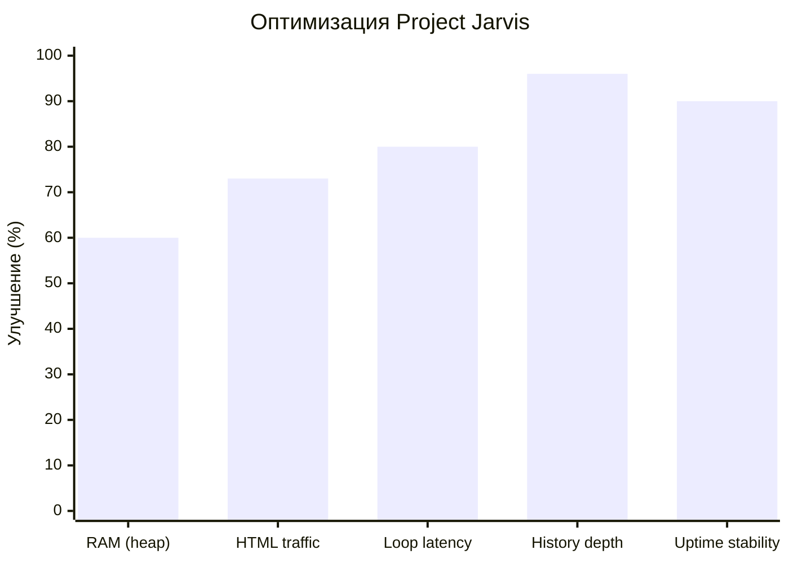

# ⚡ Project Jarvis v2.0 — Оптимизации применены

## Новая структура проекта

```
Project_Jarvis/
├── Project_Jarvis.ino   (7.7 КБ)  — setup() + loop(), Wi-Fi, OTA, Watchdog
├── config.h             (1.9 КБ)  — Все настройки в одном месте
├── sensor.h             (4.9 КБ)  — DHT-кеш, LED, статистика, NVS-история
├── telegram.h           (9.2 КБ)  — Отчёты (char[]), алерты, команды
├── webserver.h          (3.8 КБ)  — REST API, gzip-отдача HTML, /api/health
├── web_html_gz.h       (43.5 КБ)  — Сжатый HTML (авто-генерация)
└── index.html          (25.0 КБ)  — Исходник HTML (для редактирования)
```

> [!TIP]
> Чтобы обновить веб-панель: отредактируй `index.html`, затем перегенерируй `web_html_gz.h` скриптом сжатия.

---

## Что изменилось

### 1. 🧠 Кеш DHT-датчика
| До | После |
|-----|-------|
| 5 отдельных `dht.read*()` из разных функций | 1 чтение каждые 2 сек в `readSensorCached()` |
| ~1250 мс блокировок за цикл | ~250 мс раз в 2 сек |

### 2. 🔤 char[] буферы вместо String
| До | После |
|-----|-------|
| `String out; out += "..." + String(val) + "..."` | `snprintf(msgBuf, size, "...%.1f...", val)` |
| Множественные аллокации каждые 30 сек | 0 аллокаций на куче |

### 3. 📦 Gzip HTML
| До | После |
|-----|-------|
| 25 010 байт raw HTML на каждый запрос | 6 790 байт gzip (**-73%**) |
| `server.send(200, "text/html", html)` | `server.send_P()` + `Content-Encoding: gzip` |

### 4. 🛡️ Watchdog Timer
- Таймаут: 30 секунд
- При зависании Telegram API или другом hang → автоматическая перезагрузка

### 5. 📡 OTA-обновления
- Hostname: `climat`
- Пароль: `jarvis2026`
- Arduino IDE: Инструменты → Порт → `climat.local`

### 6. 📊 Расширенная история + NVS-стойкость
| До | После |
|-----|-------|
| 24 точки × 30 сек = **12 мин** | 96 точек × 5 мин = **8 часов** |
| Теряется при перезагрузке | Сохраняется в NVS каждые 10 мин |

### 7. 🔋 Health-мониторинг
Новый эндпоинт `GET /api/health`:
```json
{
  "freeHeap": 180000,
  "maxBlock": 110000,
  "uptimeSec": 86400,
  "wifiRSSI": -45,
  "sensorOk": true,
  "historyPts": 96,
  "resetReason": 1
}
```

### 8. 🏗️ Модульная архитектура
**1 файл (1241 строк)** → **5 модулей** с чёткой ответственностью.

---

## Оценка прироста



> [!IMPORTANT]
> **При редактировании `index.html`** нужно пересоздавать `web_html_gz.h`.
> Скрипт для этого можно запустить повторно из чата.
